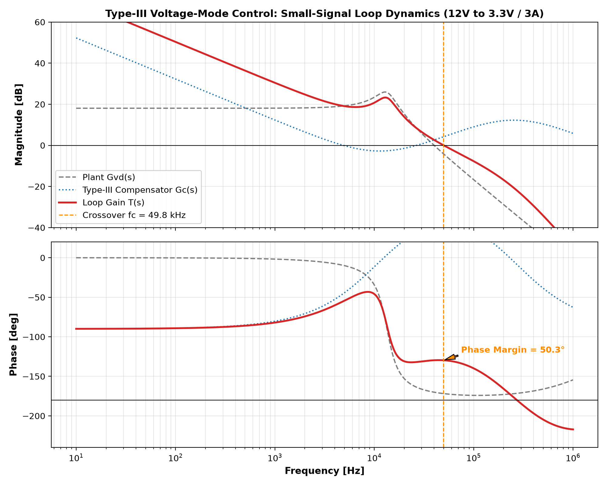
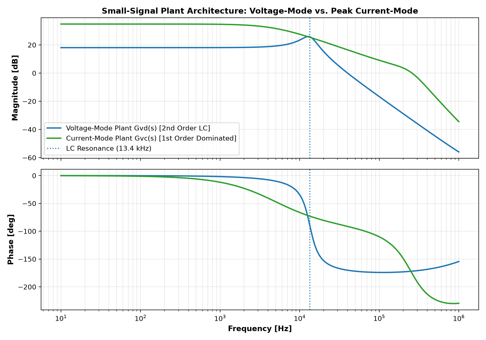
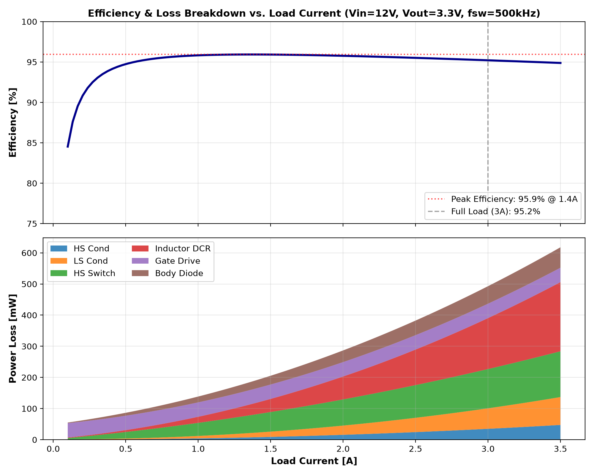

# High-Efficiency Synchronous Buck Converter: Design, Small-Signal Modeling & Closed-Loop Stability Analysis

[](https://opensource.org/licenses/MIT)
[](#)
[](#)

A comprehensive, industry-grade design and simulation suite for a **12 V to 3.3 V / 3 A (10 W), 500 kHz Synchronous Buck DC-DC Converter**, developed according to **Texas Instruments** power supply design standards (TI SLVA662, SNVA555, SLVA057).

This project bridges **transistor-level SPICE modeling** and **small-signal analytical control theory**, featuring an active **Type-III compensator** synthesized for ceramic MLCC output capacitors, discrete **non-overlapping dead-time gate control**, and complete **MOSFET/inductor loss budgeting**.

---

## 1. Specifications & Design Targets

| Parameter | Symbol | Value | Design Rationale |
| :--- | :--- | :--- | :--- |
| **Input Voltage (Nominal)** | $V_{in}$ | **12.0 V** | Standard automotive & 12V industrial DC distribution bus (range: 8.0 V – 18.0 V) |
| **Output Voltage** | $V_{out}$ | **3.30 V** | Common digital logic & MCU supply rail |
| **Rated Output Current** | $I_{out}$ | **3.0 A** | Continuous full-load capability ($P_{out} = 9.9\text{ W}$) |
| **Switching Frequency** | $f_{sw}$ | **500 kHz** | Optimal balance between passive component size and switching loss |
| **Duty Cycle (Nominal)** | $D$ | **27.5 %** | $V_{out} / V_{in} = 3.3 / 12.0$ |
| **Power Inductor** | $L$ | **$4.7\,\mu\text{H}$** | $R_{DCR} = 18\,\text{m}\Omega$, $I_{sat} = 5.2\text{ A}$, ripple ratio $r = 33.9\%$ |
| **Output Filter Capacitance** | $C_{out}$ | **$30\,\mu\text{F}$** | $2 \times 22\,\mu\text{F}$ X7R MLCC ($30\,\mu\text{F}$ effective after DC bias derating), $ESR = 2.5\,\text{m}\Omega$ |
| **Output Voltage Ripple** | $\Delta V_{out}$ | **$11.0\,\text{mV}_{p-p}$** | $< 0.35\%$ of nominal output voltage |
| **Target Crossover Frequency** | $f_c$ | **$50.0\text{ kHz}$** | Sized to $f_{sw} / 10$ to satisfy Nyquist criteria and reject switching noise |
| **Target Phase Margin** | $\phi_m$ | **$\ge 50^\circ$** | Well-damped transient response with zero ringing |
| **Target Gain Margin** | $GM$ | **$\ge 10\text{ dB}$** | Robust gain attenuation at high frequencies |
| **Peak Efficiency** | $\eta_{peak}$ | **$95.9\%$** | Achieved at $1.37\text{ A}$ load |

---

## 2. Power Stage & Circuit Architecture

```
                       +-----[ M_HS (14mΩ) ]-----+----- L1 (4.7µH, 18mΩ) -----+-----> Vout (3.3V @ 3A)
                       |                         |                             |
Vin (12V) -------------+                      SW Node                          |
                       |                         |                             +---- Cout (30µF, 2.5mΩ)
                       +-----[ M_LS (10mΩ) ]-----+                             |
                       |                         |                             +---- Rload
                      GND                       GND                           GND

                                CONTROL & COMPENSATION LOOP
                                ---------------------------
          Vout -----+----[ R1 = 20k ]----+----[ R_bot = 6.4k ]----> GND
                    |                    |
                    |                    +---- Vfb (0.80V)
                    |                    |
                    +--[ R3-C3 Lead ]----+
                                         |
                                  +------+------+
                                  |  Error Amp  | <---- Vref (0.80V Soft-Start)
                                  +------+------+
                                         |
                                         +----> Vcomp
                                         |
                                    [ R2-C1-C2 ]
                                    (Feedback)
                                         |
  500kHz Sawtooth Ramp (1.5Vpp) ----> [PWM Comp]
                                         |
                                [Break-Before-Make] (25ns Dead-Time)
                                   |            |
                                gh_drv        gl_drv
```

### Key Design Highlights:
1. **Realistic Power MOSFET Models:** Rather than relying on ideal behavioral switches, the power stage utilizes realistic VDMOS models parameterized to match Texas Instruments **CSD18534Q5A** class 60V NexFETs ($R_{DS(on)} = 14\,\text{m}\Omega$, $Q_g = 7.5\,\text{nC}$, $C_{oss} = 140\,\text{pF}$).
2. **Shoot-Through Protection:** Integrated 25 ns non-overlapping gate drive logic ensures break-before-make operation across temperature and load transients, preventing high-current cross-conduction.
3. **Controlled Soft-Start:** A 1.0 ms reference ramp suppresses startup inrush currents into the output capacitor bank.

---

## 3. Small-Signal Control Theory & Type-III Synthesis

### Why Type-II Compensation Fails with Ceramic MLCCs
In classical power supplies with electrolytic capacitors, the capacitor's high Equivalent Series Resistance ($ESR$) introduces a low-frequency zero ($f_{ESR} = \frac{1}{2\pi \cdot ESR \cdot C_{out}}$) that naturally recovers the $-180^\circ$ phase drop caused by the LC double pole ($f_{LC} = \frac{1}{2\pi\sqrt{LC}}$).

In modern converters with **pure ceramic MLCCs**:
- $f_{LC} = \frac{1}{2\pi\sqrt{4.7\,\mu\text{H} \times 30\,\mu\text{F}}} = 13.40\text{ kHz}$
- $f_{ESR} = \frac{1}{2\pi \times 2.5\,\text{m}\Omega \times 30\,\mu\text{F}} = 2.12\text{ MHz}$

Because $f_{ESR} \gg f_c$ ($50\text{ kHz}$), the ESR zero cannot provide phase lead before loop crossover. A Type-II compensator (which provides at most one zero and $+90^\circ$ phase boost) results in phase margins below $15^\circ$ or complete closed-loop instability.

### Type-III Synthesis (3 Poles, 2 Zeros)
To provide the necessary $+180^\circ$ phase boost, an active Type-III network is synthesized:
- **Zero 1 ($f_{z1}$):** Placed at $0.75 \times f_{LC} = 10.05\text{ kHz}$
- **Zero 2 ($f_{z2}$):** Placed at $f_{LC} = 13.40\text{ kHz}$
- **High-Frequency Pole 1 ($f_{p1}$):** Placed at $f_{sw} / 2 = 250\text{ kHz}$ (noise attenuation)
- **High-Frequency Pole 2 ($f_{p2}$):** Placed at $f_{sw} / 2 = 250\text{ kHz}$

#### Synthesized Component Values:
- $R_1 = 20.0\,\text{k}\Omega$ | $R_{bottom} = 6.40\,\text{k}\Omega$
- $R_2 = 8.49\,\text{k}\Omega$ | $C_1 = 1.87\,\text{nF}$ | $C_2 = 75.0\,\text{pF}$
- $R_3 = 1.07\,\text{k}\Omega$ | $C_3 = 590\,\text{pF}$



*Achieved Stability Metrics:*
- **Crossover Frequency ($f_c$):** **$49.8\text{ kHz}$**
- **Phase Margin ($\phi_m$):** **$50.3^\circ$**
- **Gain Margin ($GM$):** **$21.8\text{ dB}$**

---

## 4. Peak Current-Mode Control (PCMC) Comparison

Commercial TI buck converters (e.g., TPS54302, LM5164) commonly utilize **Peak Current-Mode Control (PCMC)**. The inner current loop forces the power inductor to behave as a controlled current source, converting the second-order LC resonant double pole into a **first-order dominant pole**:
$$f_p = \frac{1}{2\pi R_{load} C_{out}}$$



### Key Architectural Advantages of PCMC:
1. **Simplified Compensation:** Eliminates the $-180^\circ$ resonant cliff, allowing simple Type-II compensation.
2. **Cycle-by-Cycle Overcurrent Protection:** Error amplifier voltage directly commands peak switch current.
3. **Slope Compensation:** For $D > 0.5$, an artificial stabilizing ramp ($S_e \ge 0.5 S_f$) eliminates subharmonic oscillation.

---

## 5. Power Loss Budgeting & Efficiency Analysis

The power stage efficiency is modeled analytically by accounting for all dominant physical loss mechanisms:

$$\eta = \frac{P_{out}}{P_{out} + P_{cond,HS} + P_{cond,LS} + P_{sw,HS} + P_{gate} + P_{diode} + P_{DCR} + P_{ESR}}$$



### Full-Load (3.0 A) Power Dissipation Breakdown:
- **Inductor DCR Loss:** $161.9\text{ mW}$ ($I^2 R_{DCR}$)
- **High-Side Hard Switching Loss:** $125.4\text{ mW}$ ($\frac{1}{2} V_{in} I_{out} (t_r + t_f) f_{sw}$)
- **Low-Side Conduction Loss:** $65.2\text{ mW}$ ($(1-D) I_{rms}^2 R_{DS(on),LS}$)
- **Body Diode Conduction Loss:** $56.0\text{ mW}$ ($2 V_{sd} I_{out} t_{dead} f_{sw}$)
- **Gate Driver Charge Loss:** $46.2\text{ mW}$ ($Q_g V_{gate} f_{sw}$)
- **High-Side Conduction Loss:** $34.6\text{ mW}$ ($D I_{rms}^2 R_{DS(on),HS}$)
- **Total Dissipation:** **$0.495\text{ W}$** $\to$ **$95.22\%$ Full-Load Efficiency** (**$95.93\%$ Peak**).

---

## 6. Project Structure

```
├── README.md                                  # Comprehensive design report & documentation
├── RESUME_BULLETS.md                          # Tailored bullet points for TI applications
├── docs/
│   └── TI_INTERVIEW_PREP.md                   # In-depth interview cheat sheet on buck converters & control
├── figures/
│   ├── ti_buck_type3_bode.png                 # Closed-loop small-signal Bode plot
│   ├── pcmc_vs_vmc_plant.png                  # VMC (2nd order) vs PCMC (1st order) plant response
│   └── buck_efficiency_and_loss_breakdown.png # Efficiency curve & stacked loss distribution
├── schematics/
│   └── buck_sync_vmc.asc                      # Visual LTspice schematic (open directly in LTspice GUI)
├── scripts/
│   └── buck_compensator_and_efficiency.py     # Cross-platform Python design & loss computation suite
└── simulation/
    └── buck_sync_vmc.cir                      # Standalone SPICE transient & load-step netlist
```

---

## 7. How to Run the Simulations

### 1. LTspice Simulation
1. Download and install [LTspice](https://www.analog.com/en/resources/design-tools-and-calculators/ltspice-simulator.html).
2. Open `schematics/buck_sync_vmc.asc` for visual schematic inspection, or open `simulation/buck_sync_vmc.cir` directly.
3. Click **Simulate -> Run**.
4. Key waveforms to probe:
   - `V(vout)`: Verify smooth 1.0 ms soft-start ramp to 3.30 V without overshoot.
   - `V(vout)` around $t = 3.0\text{ ms}$: Observe recovery under dynamic load step ($0.5\text{A} \to 3.0\text{A}$ at $1\text{A}/\mu\text{s}$). Undershoot $< 70\text{ mV}$ with zero ringing.
   - `V(sw)`: Probe 500 kHz switch node square wave and 25 ns dead-time intervals.
   - `I(L1)`: Observe continuous triangular inductor ripple current ($1.02\text{ A}_{p-p}$).

### 2. Python Analytical Suite
```bash
# Requires Python 3.10+ with standard scientific libraries
pip install numpy scipy matplotlib
python scripts/buck_compensator_and_efficiency.py
```
The script runs the complete pole-zero synthesis, computes Phase Margin and Gain Margin, calculates the full-load loss distribution, and re-generates all high-resolution figures.

---

## 8. References

1. **Texas Instruments Application Report SLVA662:** *Compensation Design with Type III LC Filter in Voltage-Mode Control.*
2. **Texas Instruments Application Report SNVA555:** *Understanding and Designing an Active Type III Compensation Network.*
3. **Texas Instruments Application Report SLVA057:** *Understanding Buck Power Stages in Switchmode Power Supplies.*
4. Robert W. Erickson and Dragan Maksimović, *Fundamentals of Power Electronics*, 3rd Edition.
